<p align="center">
  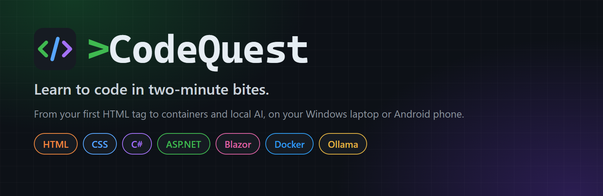
</p>

<p align="center">
  <a href="https://github.com/taylarabraham-bit/codequest-app/releases/latest"></a>
  <a href="https://github.com/taylarabraham-bit/codequest-app/releases/latest"></a>
</p>

<p align="center">
  <a href="https://github.com/taylarabraham-bit/codequest-app/releases/latest"></a>
  <a href="https://github.com/taylarabraham-bit/codequest-app/actions/workflows/release.yml"></a>
  
  
</p>

<h3 align="center">Stop watching tutorials. Type real code, get instant feedback, and level up.</h3>

<p align="center">
  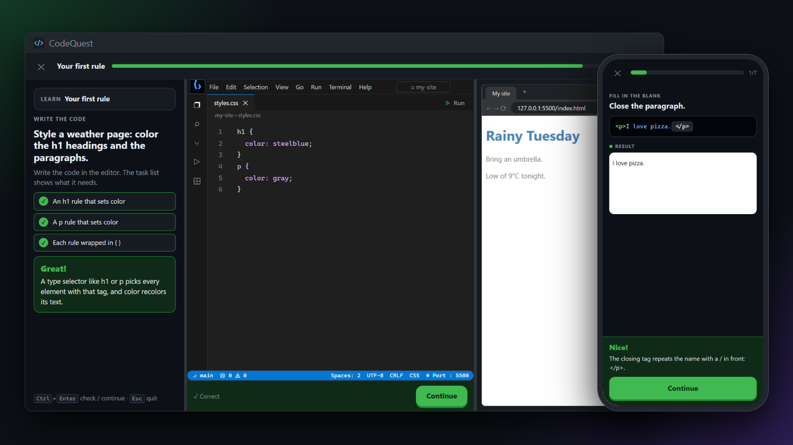
</p>

CodeQuest is a coding game with lessons short enough to fit between other things. You read one idea, then practise it straight away, earning XP, streaks and badges as you go. No account, no setup and no extra tools to install: download it and start your first lesson.

<table>
  <tr>
    <td align="center" width="25%"><h2>7</h2>tracks</td>
    <td align="center" width="25%"><h2>141</h2>units</td>
    <td align="center" width="25%"><h2>705</h2>lessons</td>
    <td align="center" width="25%"><h2>7,755</h2>exercises</td>
  </tr>
</table>

## Get started

| | Windows laptop | Android phone |
|---|---|---|
| **Edition** | Desktop: type every answer | Mobile: tap to answer |
| **File** | `CodeQuest-Desktop-N.exe` (about 110 MB) | `codequest-N.apk` (about 4 MB) |
| **Needs** | 64-bit Windows | Android 7 or newer |
| **Installing** | None: it runs from the file | Allow one install from your browser |

There's no iPhone or Mac version.

### Windows

1. Open the [latest release](https://github.com/taylarabraham-bit/codequest-app/releases/latest) and download `CodeQuest-Desktop-N.exe`.
2. Double-click it. It can take several seconds to open while it unpacks itself.
3. If Windows says *"Windows protected your PC"*, click **More info**, then **Run anyway**. This appears because the app isn't code-signed.

To update, download the newer `.exe`. Your progress is kept in `%APPDATA%\codequest`. To remove the app, delete the `.exe` and that folder.

### Android

1. On your phone, open the [latest release](https://github.com/taylarabraham-bit/codequest-app/releases/latest) and download `codequest-N.apk`.
2. Open the download. The first time, Android asks you to allow installs from your browser: turn on **Allow from this source**.
3. Tap **Install**.

To update, install a newer APK over the old one. Your progress is kept.

## What you'll learn

Every track runs from beginner to job-ready and ends in a capstone project.

<p align="center">
  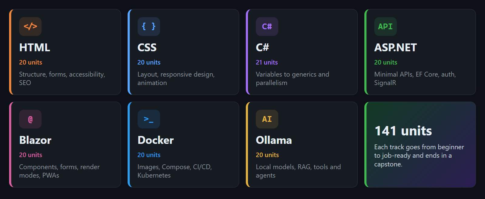
</p>

## How it plays

| | |
|---|---|
| **Learn one idea** | Each lesson takes about 2 minutes: one concept card, then 7 hands-on exercises. |
| **Practise five ways** | Fill in the blank, build the code, put lines in order, find and fix the bug, and type a line. Each unit starts easy and gets harder. |
| **See it work** | HTML and CSS render in a live preview, and the other tracks show the program's output. |
| **Learn from mistakes** | A wrong answer gets a hint. A second miss shows the answer and explains it, then adds the question to a review queue spaced over 1, 3 and 7 days. |
| **Beat the boss** | Every unit ends with a 10-question boss. |
| **Earn your certificate** | Clear a track to unlock its 20-question final exam. Get 17 right to earn the certificate. |
| **Skip what you know** | Get 7 of 8 right on a skip-ahead test to jump past units. |

## Desktop edition

Built for a keyboard, with screens styled like the tools you'll use on the job.

<p align="center">
  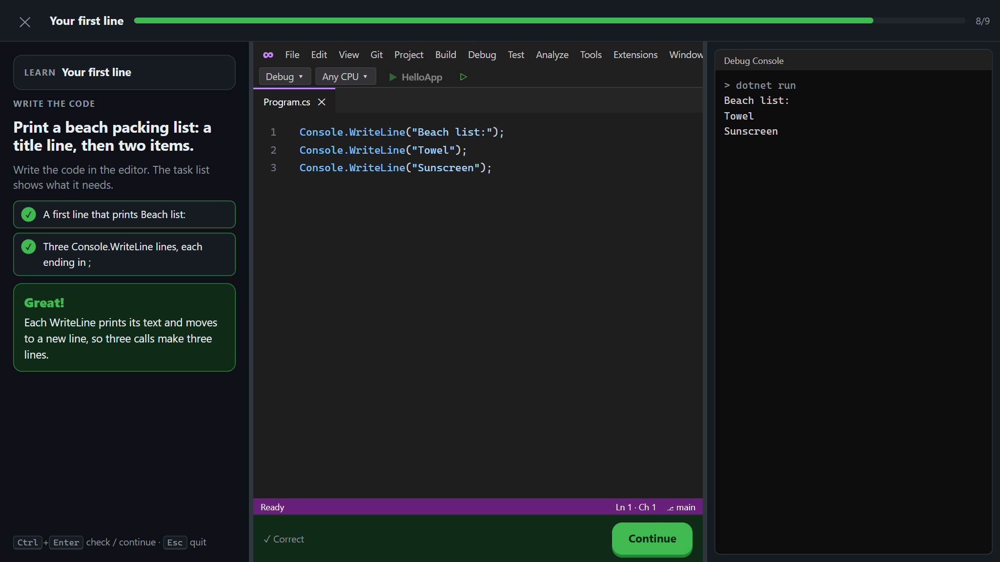
  <br><em>Write the code against a task checklist, then see what it prints.</em>
</p>

<table>
  <tr>
    <td width="50%">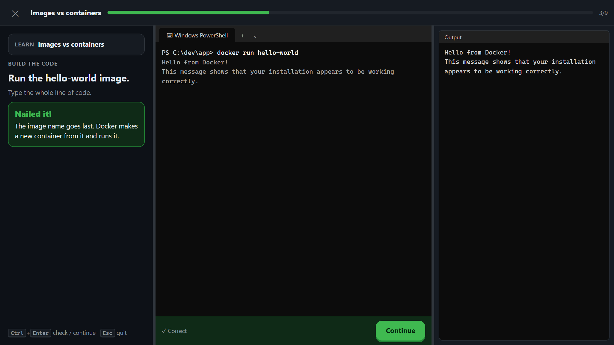<p align="center"><em>Practise commands at a PowerShell prompt</em></p></td>
    <td width="50%">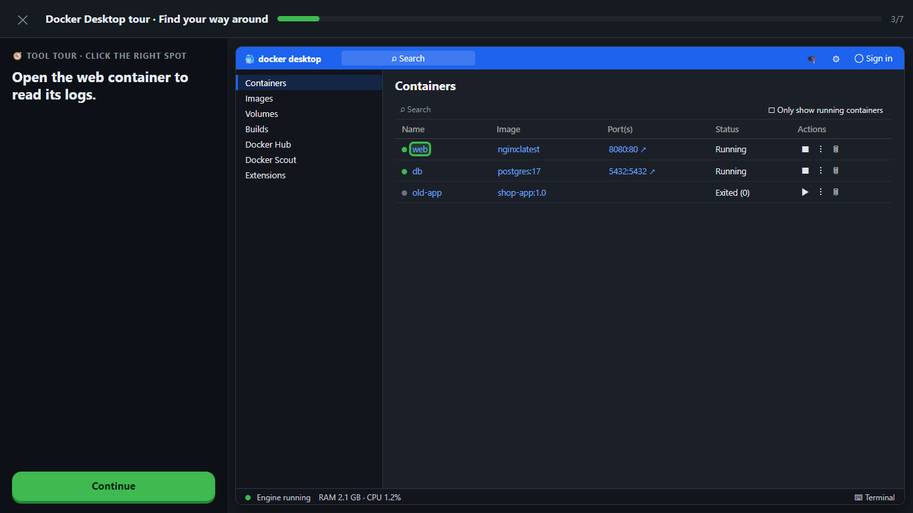<p align="center"><em>Tool tour: find your way around Docker Desktop</em></p></td>
  </tr>
  <tr>
    <td width="50%">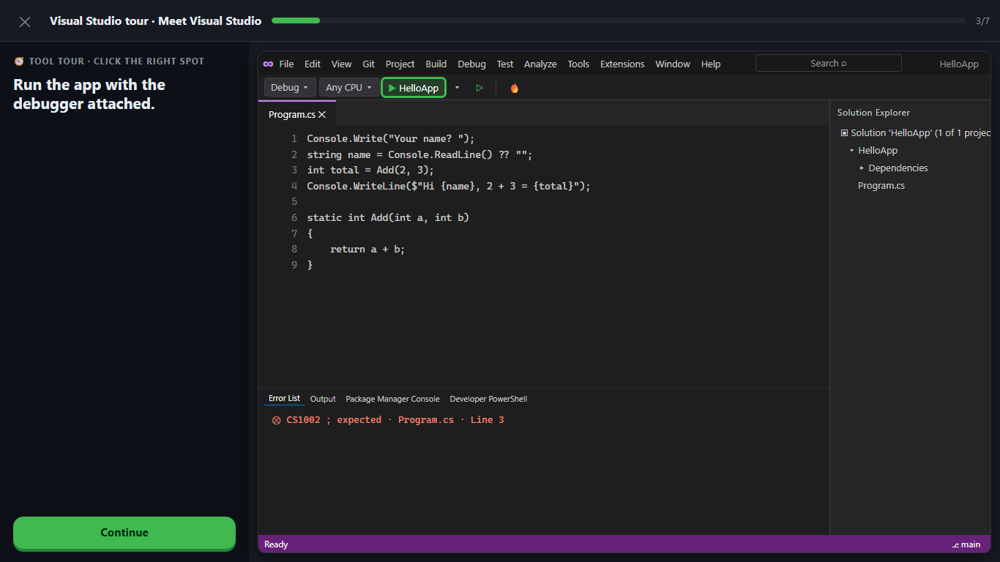<p align="center"><em>Tool tour: run and debug in Visual Studio</em></p></td>
    <td width="50%">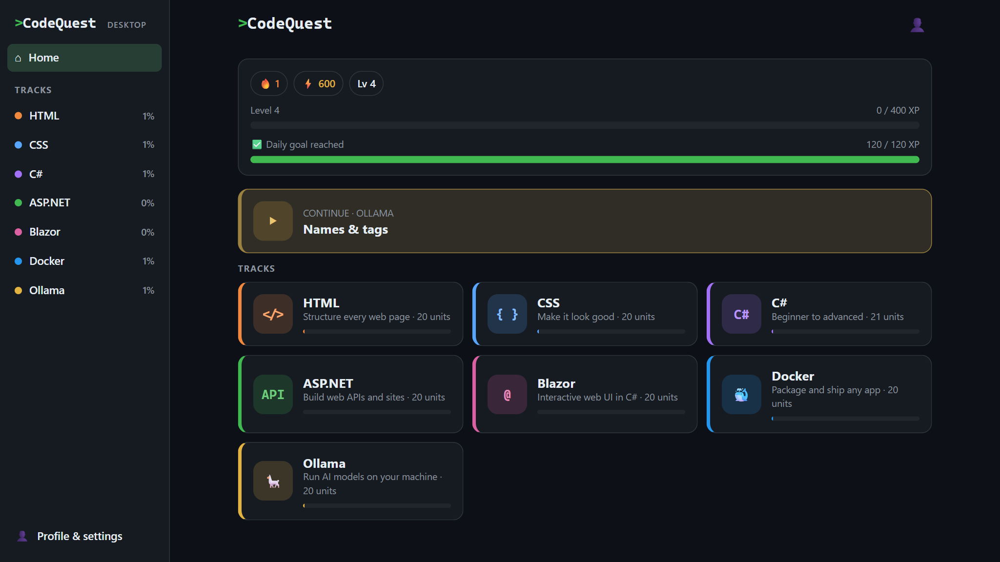<p align="center"><em>Pick up where you left off</em></p></td>
  </tr>
</table>

- **Three-pane lessons:** resizable Instructions, Code and Output panes.
- **Write-the-code challenges:** 1,410 extra challenges, 2 per lesson, written in an editor against a task checklist.
- **14 tool tours:** click-through practice on mock versions of VS Code, Visual Studio, browser DevTools, Docker Desktop and Windows Terminal, plus typed command walkthroughs.
- **Windows commands:** command lessons use Windows PowerShell.
- **Keyboard first:** `Ctrl+Enter` to check and continue, `Esc` to quit, `Tab` between blanks, `Alt+↑/↓` to reorder lines.

You don't need Docker, .NET or Ollama installed. The editors and terminals are built into the app, and it checks your answers itself.

## Mobile edition

The same lessons, made for one thumb.

<table>
  <tr>
    <td align="center" width="33%">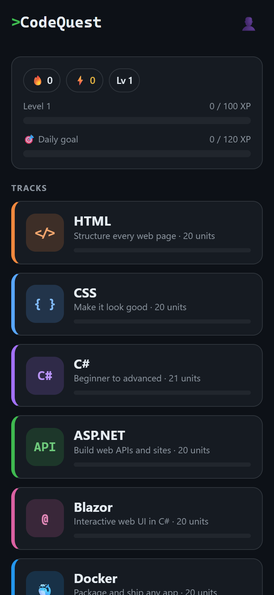<br><em>Choose a track</em></td>
    <td align="center" width="33%">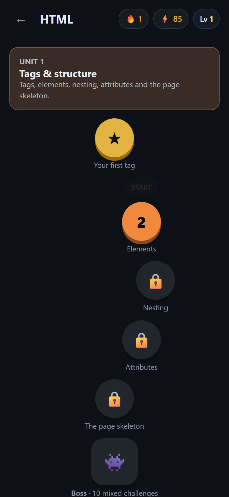<br><em>Work up to the boss</em></td>
    <td align="center" width="33%">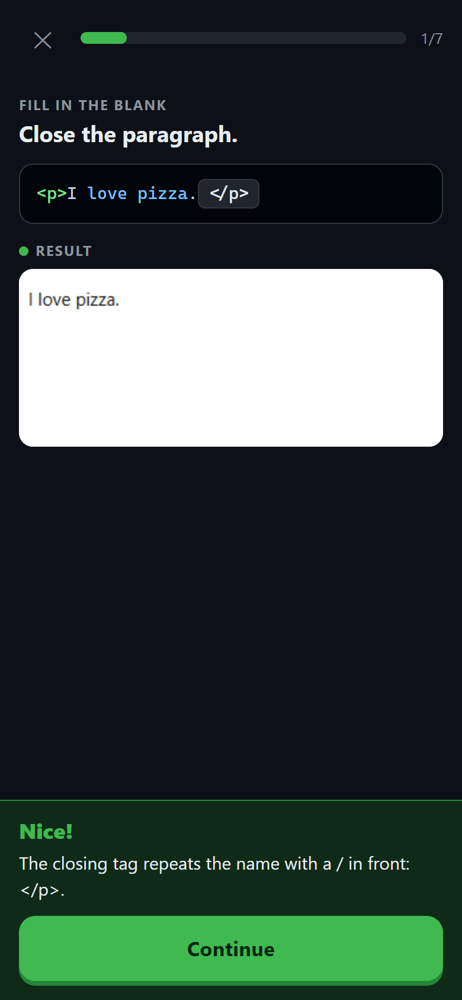<br><em>Tap, check, repeat</em></td>
  </tr>
</table>

## Keep your streak going

<p align="center">
  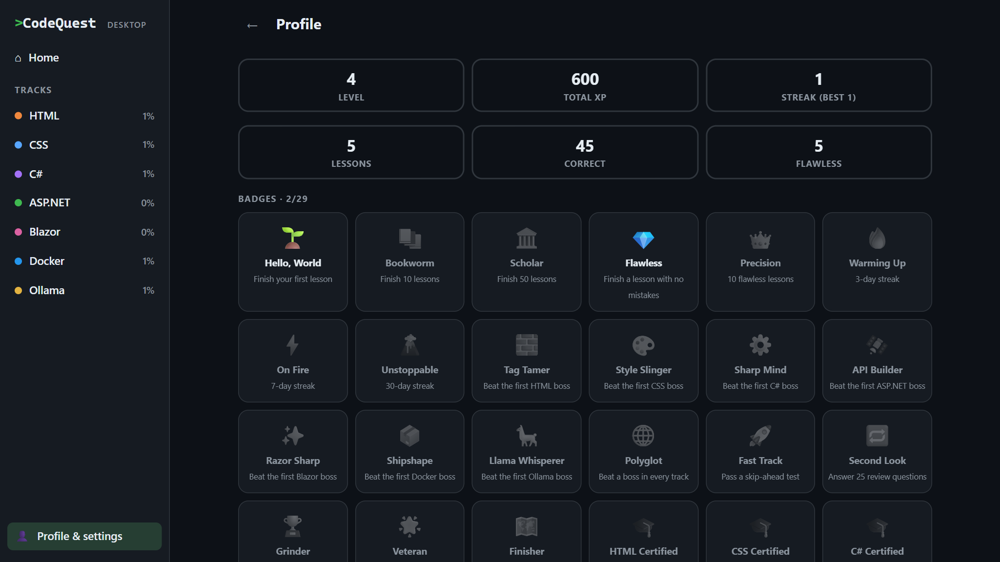
</p>

XP and levels, a daily streak, a daily goal you set yourself, 29 badges to collect, and settings for sound, vibration, reduced motion and larger code text.

## Private by design

There are no accounts, ads or analytics, and the app doesn't send your data anywhere. Your progress stays on your device, so each device keeps its own.

## For developers

Built with React, TypeScript and Vite, packaged with Electron for Windows and Capacitor for Android. You'll need Node 22 or newer.

```bash
git clone https://github.com/taylarabraham-bit/codequest-app.git
cd codequest-app
npm install
```

```bash
npm run dev          # phone edition at http://127.0.0.1:5180
npm run dev:desktop  # desktop edition at http://127.0.0.1:5181
npm run app          # build the desktop edition and open it in Electron
npm run dist:win     # build the portable .exe into release/
```

```bash
npm test             # engine tests and validation of every exercise
npm run lint && npm run typecheck
RUN_DOTNET=1 npx vitest run tests/csharp-run.test.ts   # needs the .NET 10 SDK: runs every C# exercise
```

<details>
<summary><strong>Browser playthrough tests</strong></summary>

Run these with the matching dev server up. Set `CHROMIUM=/path/to/chromium` to use a browser you already have.

```bash
node scripts/smoke.mjs shots                  # plays HTML lesson 1 on the phone edition
ALL=1 node scripts/smoke.mjs shots            # plays every lesson, boss and unlocked exam
node scripts/smoke-desktop.mjs shots-desktop  # types answers at laptop size in every track
ALL=1 node scripts/smoke-desktop.mjs shots-desktop   # every lesson, boss, exam and tour, by typing
ALL=1 TRACKS=docker,ollama node scripts/smoke.mjs shots   # just some tracks
```

</details>

<details>
<summary><strong>Adding lessons</strong></summary>

Create `src/content/<track>/unitNN.ts` following the [content guide](docs/CONTENT_GUIDE.md), and the game picks it up automatically. `npm test` checks every exercise's shape, the difficulty ramp, and that each answer passes the checker, both tapped and typed. Tool tours live in `src/content/tours/`.

</details>

<details>
<summary><strong>How it fits together</strong></summary>

| Path | What |
|---|---|
| `src/engine/types.ts` | Content data model (5 exercise kinds) |
| `src/engine/check.ts` | Answer checking, tokenizing, previews |
| `src/engine/progress.ts` | XP, levels, streaks, unlocks, badges, review queue (pure functions) |
| `src/screens/Session.tsx` | The lesson, boss, review and skip-test runner |
| `src/screens/sessionRunner.ts` | The check, hint and reveal loop shared by both editions |
| `src/components/exercises/` | The exercise widgets; `desktop/` holds the typed versions |
| `src/screens/desktop/` | Desktop shell, three-pane lesson screen, tool-tour screen |
| `src/components/desktop/` | Tool-styled editor frames, mock terminal, output windows and tour mocks |
| `src/content/tours/` | Tool tours, per track |
| `src/edition.ts` | `DESKTOP` flag, set by `vite --mode desktop` |
| `electron/main.cjs` | Electron shell for the Windows app |
| `android/` | Capacitor Android wrapper |
| `.github/workflows/release.yml` | Builds and publishes the APK and the `.exe` on every push to `main` |

CI signs the APK with a key held in GitHub secrets, so every build can update the installed app. Without the key, `assembleRelease` produces an unsigned APK.

</details>
